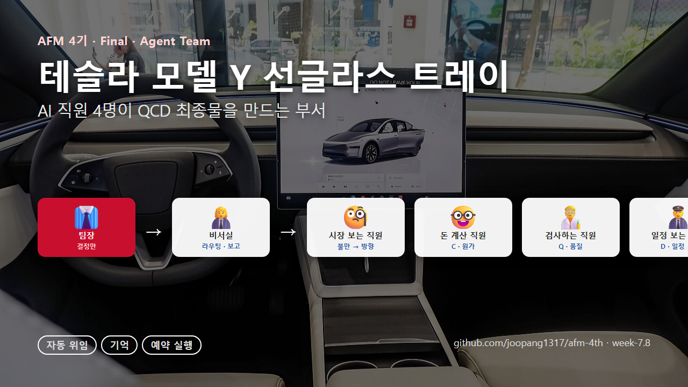

# AI 직원 4명이 테슬라 용품 하나를 만드는 법 — 에이전트 팀 v1



> AFM 4기 Final · Agent Team. 자동차 용품 회사 제품개발팀의 **AI 직원 4명 + 비서실 1**.
> 사람(팀장)은 결정만 하고, 나머지는 직원들이 매뉴얼대로 한다. ⚠️ 회사·공장·금액은 전부 **가상값**.

| 시연 | 링크 |
|---|---|
| 발표 장표 3장 (배포 URL) | https://claude.ai/artifact/P4psmhW8ruqAURMfq76vUM — ① 타겟 시장·제품·파츠 ② 에이전시 구동(클릭 진행) ③ QCD 최종물 |
| 에이전트 폴더 | 이 저장소 `afm-4th/week-7.8/final-agent-team/` |
| 실행 증거 | `완료문서/` 5개 · `로그/위임테스트_261024.log` · `로그/예약실행.log` |

## 이 차에 붙이는 물건 두 가지 (테슬라 모델 Y, 2025년식)
| | 물건 | 만드는 방법 | 쉽게 말하면 |
|---|---|---|---|
| ① | **선글라스 트레이** (운전석 사이 수납공간) | **직접 만든다** — 모양을 그리고 플라스틱 찍어내는 틀(금형)을 만들어 생산 | 시장에 "새 모델에 딱 맞는 것"이 없어서 우리가 설계. 틀 값이 비싸고 오래 걸리지만 남이 못 베낀다 |
| ② | **트렁크 사이드 보관함** (좌·우 + 뚜껑) | **사와서 판다** — 잘 만들어진 물건을 사 오고 상자(패키지)만 우리 것 | 물건은 있는데 "뚜껑 없음·설명 부족"이 불만. 뚜껑 있는 걸 골라 사 오면 3주 만에 판다 |

## AI 직원 4명 — 하는 일 / 절대 안 하는 일
| 직원 | 파일 | 하는 일 (매뉴얼대로) | 절대 안 하는 일 |
|---|---|---|---|
| 시장 보는 직원 | `.claude/agents/시장조사담당.md` | 후기 읽고 불만 세기 · "얼마까지 팔 수 있나" 정하기 · 직접 만들지 사 올지 제안 | "이거 팔린다" 단정 |
| 돈 계산 직원 | `.claude/agents/원가담당.md` | 팔 값에서 거꾸로 "만들 값 상한" 계산 · 공장 견적 비교표 | 공장에 답장 · 주문 |
| 검사하는 직원 | `.claude/agents/품질인증담당.md` | 샘플 자로 재기·흔들기 · 로고·표기 확인 · 수정 요청문 초안 | 합격 확정 · 시험 접수 |
| 일정 보는 직원 ⏰ | `.claude/agents/입고일정담당.md` | **매주 월요일 9시 혼자 켜져서** 도착일 변동·늦은 것·알릴 것 표시 | 회사 시스템 수정 · 공장 재촉 발송 |
| 비서실 (메인) | `AGENTS.md` | 요청을 읽고 누구에게 줄지 정함 · 아침에 "오늘 뭐 할지" 정리 · 결과 3줄 요약 | 직원 일을 대신 함 |

**사람(팀장)이 하는 일** — 어느 길로 갈지 · 공장 고르기 · 보내기 버튼 · 합격 도장. 하루 10분.

## 한 바퀴 돌린 결과 (가상 숫자)
| | ① 선글라스 트레이 (직접) | ② 사이드 보관함 (사와서) |
|---|---|---|
| 시장 | 불만 1위 "새 모델엔 안 맞아요" → 직접 만들자 · 팔 값 상한 24,900 | 불만 "뚜껑 없어 짐이 보여요" → 뚜껑 있는 완제품 사 오자 · 상한 39,800 |
| 돈 | 한 개 6,800원 안에 만들어야 하는데 공장 3곳 9,000~13,700 → **다 넘침** → 많이 만들기 / 비싸게 팔기 / 안감 빼기 | 틀 값 없음, 우리 상자 600원 → 6,600~8,200 → **다 통과** |
| 검사 | 폭 1.4mm 큼 · 덜컹 2회 → **다시 만들어 와** | 20개 중 작은 흠 3개(허용 2) → **잠깐 보류** |
| 일정 | 샘플 6일 늦음 🔴 → "기다릴까 재촉할까" 택1 | 물건 10/30 · 우리 상자 10/28(2일 먼저 ✓) → 촬영팀·고객팀에 알림 |

## 최종 산출물 형식 — "QCD 최종물" (발표 장표 3장과 같은 순서)
`QCD 최종물` 또는 `한 바퀴 돌려줘`라고 하면 직원 4명이 돈 뒤 비서실이 `서식/QCD최종물.md`로 한 장을 만든다.
1. **타겟 시장 · 제품 · 파츠** — 차량 › 제품군 › 파츠 · 어디에 붙나 · 시장 현황
2. **에이전시 구동** — 직원 4명 각 1줄 (한 일 · 넘긴 것 · 저장)
3. **QCD 최종물** — 제안 표 + Q / C / D 세 칸 + 결론 1줄 + 팀장님 결정 3개

쉬운 말 · 한 칸 3줄 · 새 숫자 금지(담당자 문서에서만 옮김). 예: `완료문서/261024-QCD최종물-SG01.md`

## 숙제 요건 — 세 장면
1. **이름 안 불러도 넘어간다** — `받은요청 폴더에 있는 거 다 처리해줘` 한 줄이면 4명이 알아서 나눠 가진다 (AGENTS.md의 "이런 말이 있으면 → 이 직원" 표).
2. **지난번 정한 걸 기억한다** — `CLAUDE.md` 첫 줄 "일을 시작하기 전에 MEMORY.md를 먼저 읽는다". 규칙("틀 값은 개수로 나눠 넣어라", "2025년식인지 꼭 써라")은 `MEMORY.md`, 직원별 수첩은 `agent-memory/<직원>/MEMORY.md`(날짜 붙은 다음 할 일).
3. **안 시켜도 정해진 시각에 돈다** — `scripts/register_task.ps1` → 매주 월 09:00 일정 보는 직원 실행. 멈추는 장치 3개: 이번 주 자료 없으면 멈춤 · 같은 날 2번 금지 · 40턴/15분 한도. 로그 `로그/예약실행.log`.

## 폴더
```
CLAUDE.md          첫 줄 "MEMORY.md 먼저" + AGENTS.md 포함
AGENTS.md          비서실 — 누구에게 줄지 표 · 아침 정리
MEMORY.md          팀 규칙·예외 (결과물 X)
me.md · 업무규칙.md 회사·물건·직원 표 / 규칙
.claude/agents/    직원 4명 (한 장씩)
agent-memory/      직원별 수첩
memory/팩트시트.md  숫자 기준 (환율·관세·상자값·목표 원가율·모델 연식)
자료/ 시장·원가·입고·품질   직원이 읽기만 하는 자료 (가상)
받은요청/ 01~06 → 완료문서/   요청 → 결과물 (서식/ 4종)
scripts/           계산기 4개 + 월요일 자동 실행 2개
로그/              자동 실행 기록
```

## 처음 여는 사람
1. **이 폴더**(`final-agent-team`)를 VS Code로 열고 Claude 세션을 연다 (상위 폴더에서 열면 직원이 안 보임).
2. `받은요청 폴더에 있는 거 다 처리해줘` → `완료문서/`에 6개.
3. `/clear` 후 `TS-02 원가` → 설명 없이 규칙이 반영되는지.
4. `powershell -ExecutionPolicy Bypass -File scripts/register_task.ps1` → `schtasks /Run /TN MT빌더_입고점검_주간` → `로그/예약실행.log`.

## 안전장치
회사 장부는 읽기만 · 숫자는 계산기(scripts)로만 · 자료 없으면 지어내지 않고 멈춤 · 테슬라 로고 안 씀 · 연식(구형/2025년식/Y L) 꼭 표기 · 보내기·결재는 사람.

## 회고 (261024)
- **잘 된 점**: 수업 틀(총무 kit + 하루 kit)을 그대로 두고 안의 사실만 우리 일로 바꿨더니 하루 만에 섰다. "직접 만드는 길"과 "사와서 파는 길"을 같은 4명이 다른 계산·다른 검사로 굴리는 구조가 우리 회사(빠른 게 강점, 품질·원가가 약점)에 맞았다. 설명을 "쉬운 말"로 다시 쓰니 비전문가도 흐름을 따라왔다.
- **아쉬운 점**: 자료가 가상이라 실제 인터넷 검색·회사 장부 읽기는 빠졌다(다음 1순위). 마케팅 직원은 아직 없다. 자동 실행은 PC가 켜져 있어야 한다.

## 발표 장표 (최종)
- 발표/261024_발표장표_최종.html — ① 왜 이 방향인가 ② 타겟 시장·제품·파츠 ③ 에이전시 구동(클릭 진행) ④ QCD 최종물 ⑤ 회고 3문 · 브라우저로 열면 됨
- 차량 사진: Wikimedia Commons (OWS Photography CC BY 4.0 · Ethan Llamas CC BY-SA 4.0)
